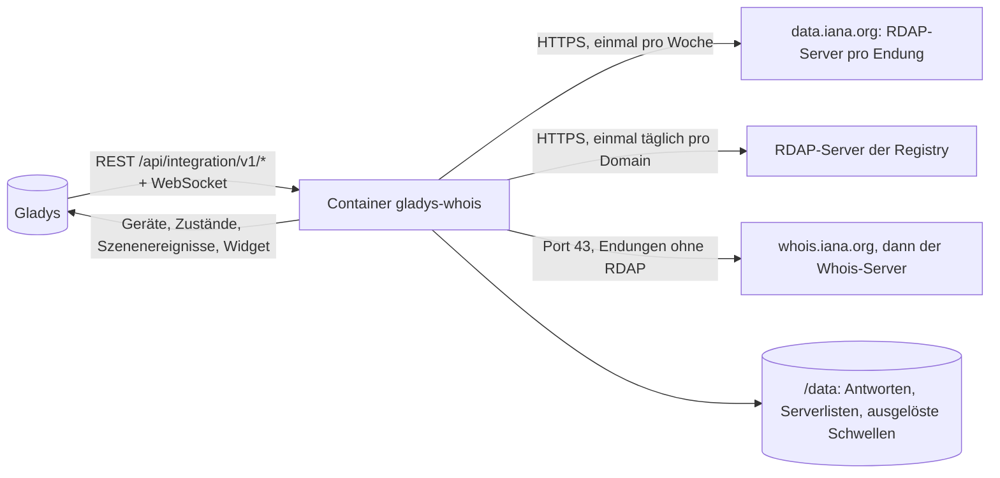
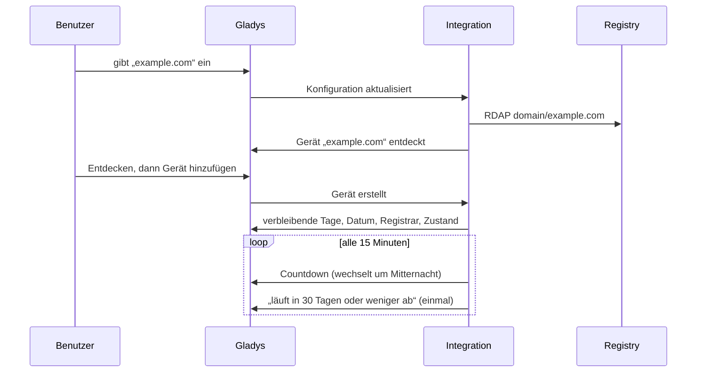
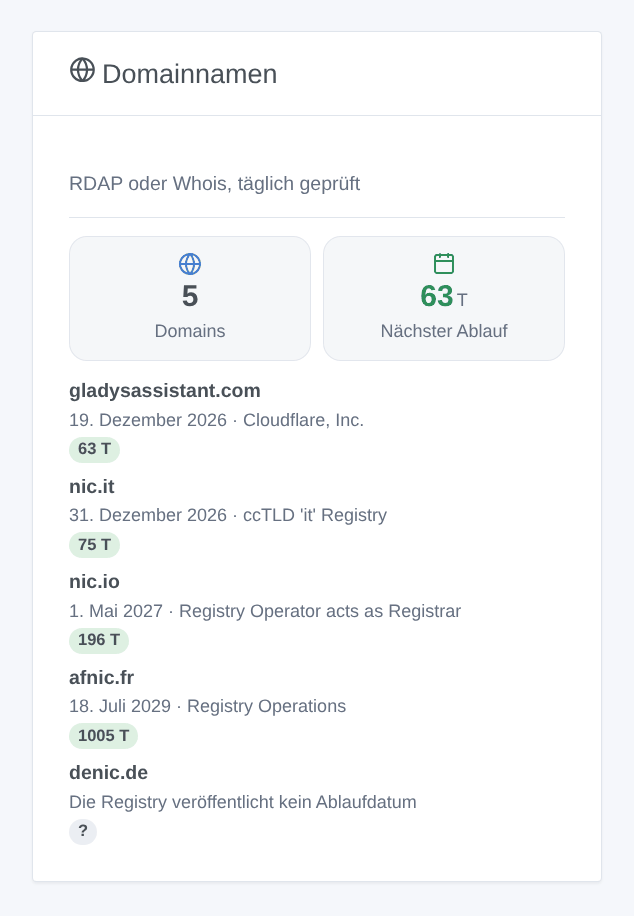

# Gladys Whois

[English](README.md) · [Français](README.fr.md) · **Deutsch** · [Español](README.es.md)

[](LICENSE)
[](https://github.com/William-De71/gladys-whois/releases)
[](https://github.com/William-De71/gladys-whois/actions/workflows/release.yml)
[](https://gladysassistant.com)


Externe Integration für [Gladys Assistant](https://gladysassistant.com), die den **Ablauf Ihrer Domainnamen** überwacht: verbleibende Tage, Ablaufdatum, Registrar und Zustand, einmal täglich bei jeder Registry über RDAP geprüft, oder über Whois für Endungen ohne RDAP. Szenen warnen Sie Wochen vor dem Ablauf einer Domain, und ein Widget listet sie auf, der nächste Ablauf zuerst.

Benutzerdokumentation: [English](docs/en.md) · [Français](docs/fr.md) · [Deutsch](docs/de.md) · [Español](docs/es.md).

> Community-Integration, mit keiner Registry und keinem Registrar verbunden.

## Funktionen

- Bis zu **10 Domains**, als Namen oder Webadressen eingegeben (`https://www.example.de/` ist `example.de`), internationalisierte Namen inklusive (`café.fr`).
- Ein **Gerät pro Domain**: Tage bis zum Ablauf, Ablaufdatum, Registrar, Zustand (aktiv, läuft bald ab, abgelaufen, Wiederherstellungsfrist, Löschung steht bevor).
- **2 Szenenauslöser** (läuft in N Tagen oder weniger ab, von 90 bis zum Tag selbst; verlängert), **1 Szenenaktion** (Ablauf lesen) und **1 Widget**.
- **RDAP** für .com, .net, .org, .fr, .uk, .nl und die meisten Endungen (Serverliste der IANA), **Whois** für die anderen (.io, .it…). Kein Konto, kein Schlüssel.
- Eine Anfrage pro Domain und Tag, Antworten in `/data` gespeichert; der Countdown folgt dem lokalen Tag von Gladys.
- Vier Sprachen überall: Englisch, Französisch, Deutsch, Spanisch.

## Funktionsweise




Von der Konfiguration zu einer Szene:



Der RDAP-Server jeder Endung stammt aus der Bootstrap-Datei der IANA (RFC 9224); für Endungen ohne einen wird der Whois-Server einmal bei whois.iana.org erfragt, dann auf Port 43 abgefragt und seine Textantwort mit den Feldnamen der Registries gelesen.

### Transport

`transports: ["cloud"]`: Die Integration fragt die Registries über das Internet ab. Nur der Domainname steht in den Anfragen; nichts über Sie verlässt Ihr Netzwerk.

## Geräte und Funktionen

| Funktion            | Kategorie / Typ        | Einheit |
| ------------------- | ---------------------- | ------- |
| Tage bis zum Ablauf | `duration` / `integer` | Tage    |
| Ablaufdatum         | `text` / `text`        | —       |
| Registrar           | `text` / `text`        | —       |
| Zustand             | `text` / `text`        | —       |

Ein Gerät pro Domain, die externe ID auf dem ASCII-Namen der Domain aufgebaut (`example.de`, `xn--caf-dma.fr`). Eine Domain, deren Registry kein Ablaufdatum veröffentlicht (.de, .eu, .be, .ch), erhält kein Gerät: Widget und Verbindungsstatus nennen den Grund.

## Szenenauslöser, Aktionen und Widgets



**Widget**: Domainnamen (Anzahl, Tage bis zum nächsten Ablauf, dann jede Domain mit Datum, Registrar und verbleibenden Tagen als farbigem Abzeichen).

**Auslöser**:

- **Domain: läuft bald ab** — in 90, 60, 30, 14, 7, 3 oder 1 Tag oder weniger, oder am Tag selbst; einmal pro Ablaufdatum, nur die dringendste, wenn mehrere auf einmal erreicht werden.
- **Domain: verlängert** — das Ablaufdatum wurde verschoben.

**Aktion**: den Ablauf einer Domain lesen, mit einer Zusammenfassung für eine Nachricht.

Beispiele:

- 30 Tage vorher → „example.com läuft in 30 Tagen ab (19. Dezember 2026).“ per Telegram senden.
- 7 Tage vorher → eine Benachrichtigung auf allen Handys im Haus.
- Verlängert → dem Kassenwart des Vereins danken.

## Voraussetzungen

- Gladys Assistant **5.3.0** oder neuer (Widgets und Szenen; Katalog-Schlagwörter und -Länder von Gladys 5.3): ältere Instanzen können die Integration nicht installieren.
- Internetzugang von Gladys, Port 43 inklusive für die Whois-Endungen. Kein Konto, kein Schlüssel.

## Installation

- **Aus dem Store**: Integrationen → Whois → Installieren.
- **Über die Repository-URL**: Integrationen → externe Integration → `https://github.com/William-De71/gladys-whois`.
- **Entwicklermodus**: `npm start` mit den von Gladys gelieferten Variablen ausführen (siehe Entwicklung).

## Konfiguration

| Feld              | Standard    | Rolle                                                          |
| ----------------- | ----------- | -------------------------------------------------------------- |
| Domainnamen       | —           | Bis zu zehn, durch Kommas getrennt (`example.com, example.de`) |
| Sprache der Texte | automatisch | Funktionsnamen, Textzustände und Szenen-Zusammenfassungen      |

Schaltflächen: **Domain prüfen** (fragt sofort eine beliebige Domain ab, ohne sie zu überwachen), **Jetzt prüfen**, **Diagnose** (schreibt den Zustand der Integration in den Reiter Protokolle, für einen Fehlerbericht: Gladys gibt `DEBUG` nicht an den Container weiter).

## Verwendung

1. Geben Sie Ihre Domainnamen ein.
2. **Entdecken**, dann die Geräte hinzufügen.
3. Das Widget zu einem Dashboard hinzufügen und Szenen mit den Auslösern und der Aktion erstellen.

## Entwicklung

```bash
npm install
npm test                       # node --test, berührt nie das Netzwerk
npm run lint                   # ESLint
npm run format:check           # Prettier
npx github:GladysAssistant/integration-store . --skip-image-check
scripts/build-cover.sh         # cover.jpg aus docs/assets/cover.svg
docs/illustrations/render.sh   # docs/assets/widgets.<Sprache>.png
```

Lokal liest das SDK `GLADYS_HOST_API_URL`, `GLADYS_INTEGRATION_TOKEN` und `GLADYS_INTEGRATION_SELECTOR` (von Gladys im Entwicklermodus geliefert); `TZ` legt die Zeitzone fest. `DEBUG=gladys-integration-sdk` zeigt die SDK-Protokolle.

Die Tests verwenden echte Antworten der Registries (RDAP von Verisign und Afnic, Whois von .io, .it und .de): Lesen von RDAP und Whois, Datumsangaben, Domainnamen, Geräte (die Felder, die der Erkennungsbildschirm verlangt), Szenenereignisse (einmal pro Schwelle, Verlängerung), Widget (`validateWidgetContent`), Manifest, vier Sprachen, Release-Skript und die ganze Integration gegen das Fake-Gladys des SDK. `test/structure.test.js` friert jeden von Benutzern gespeicherten Schlüssel ein.

## Release-Prozess


Jeder Merge auf `main` startet die CI und berechnet dann die Version aus den [Conventional Commits](https://www.conventionalcommits.org/) seit dem letzten Tag: `feat` → Minor, `fix` / `perf` → Patch, `!` oder `BREAKING CHANGE` → Major (ein Minor unter 1.0.0); `docs`, `chore`, `ci`, `test`, `style`, `refactor`, `build` allein veröffentlichen nichts. Der Changelog-Abschnitt wird erzeugt, der Tag gepusht, das Multi-Architektur-Image gebaut, dann erhält `main` den Release-Commit, das GitHub Release wird erstellt und ein letzter Job prüft das öffentliche Image, den Store-Validator und das Topic.

- Der Titel des Pull Requests wird zum Squash-Commit und dann zur Changelog-Zeile: auf Englisch schreiben, für den Benutzer (`pr-title.yml` prüft ihn). `CHANGELOG.md` nie von Hand bearbeiten.
- 1.0.0 ist eine Entscheidung: Actions → Release → Run workflow mit `release-as: 1.0.0`. `dry-run` zeigt Version und Notizen, ohne etwas zu veröffentlichen.
- **Geschützter Branch**: Der Release pusht seinen Commit mit `GITHUB_TOKEN` auf `main`. Mit einer Regel auf `main` GitHub Actions zur Bypass-Liste hinzufügen (oder über eine GitHub App pushen), sonst schlägt der Publish-Job mit Anweisungen fehl.
- Nach dem ersten Release prüfen, dass das `ghcr.io`-Paket öffentlich ist (Package settings → Change visibility), sonst kann Gladys es nicht herunterladen.

## Fehlerbehebung

Siehe [docs/de.md](docs/de.md#fehlerbehebung). Melden Sie Probleme mit den Versionen von Gladys und der Integration, der betroffenen Domain und der Ausgabe der Schaltfläche **Diagnose** (Reiter Protokolle).

## Mitwirken

Issues und Pull Requests willkommen. Vor einem Pull Request `npm run format:check && npm run lint && npm test` ausführen und jede externe ID und jeden gespeicherten Schlüssel unverändert lassen (siehe [CLAUDE.md](CLAUDE.md)).

## Sicherheit

Siehe [SECURITY.md](SECURITY.md): Schwachstellen privat melden. Die Integration hat kein Geheimnis und kein Konto; sie schreibt nur nach `/data`.

## Kommende Screenshots

Die Bilder oben sind Illustrationen, keine Screenshots. Echte Screenshots kommen nach `docs/assets/screenshots/` (PNG, 1280 × 800): `configuration.png`, `discovery.png`, `device.png`, `scene.png`.

## Lizenz

[Apache-Lizenz 2.0](LICENSE) — siehe auch [NOTICE](NOTICE). Die Registrierungsdaten gehören den Registries; dieses Repository enthält nur einige für die Tests aufgezeichnete Antworten.
