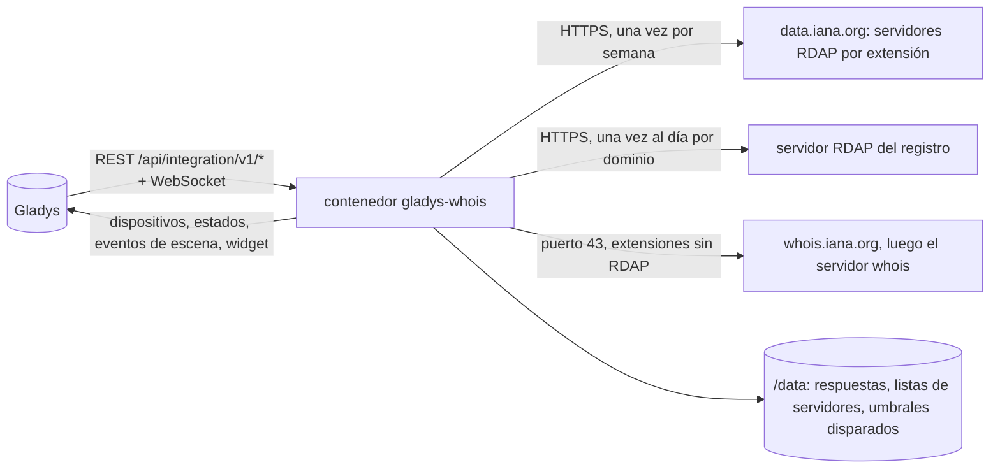
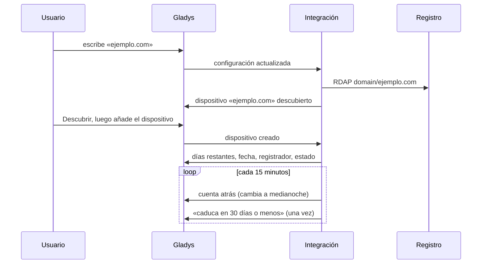
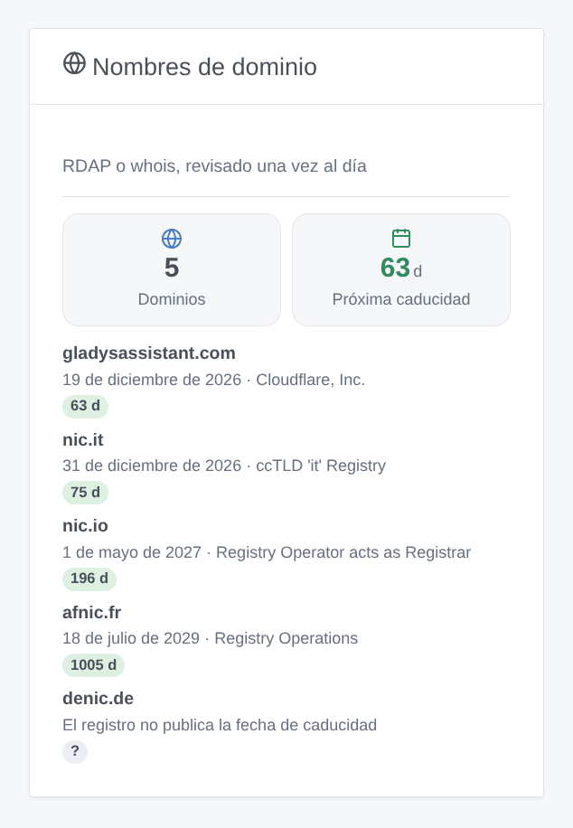

# Gladys Whois

[English](README.md) · [Français](README.fr.md) · [Deutsch](README.de.md) · **Español**

[](LICENSE)
[](https://github.com/William-De71/gladys-whois/releases)
[](https://github.com/William-De71/gladys-whois/actions/workflows/release.yml)
[](https://gladysassistant.com)


Integración externa de [Gladys Assistant](https://gladysassistant.com) que sigue la **caducidad de sus nombres de dominio**: días restantes, fecha de caducidad, registrador y estado, comprobados una vez al día con cada registro mediante RDAP, o whois para las extensiones sin RDAP. Las escenas le avisan semanas antes de que caduque un dominio, y un widget los enumera, la caducidad más próxima primero.

Documentación de usuario: [English](docs/en.md) · [Français](docs/fr.md) · [Deutsch](docs/de.md) · [Español](docs/es.md).

> Integración comunitaria, no afiliada a ningún registro ni registrador.

## Funciones

- Hasta **10 dominios**, escritos como nombres o direcciones web (`https://www.ejemplo.es/` es `ejemplo.es`), nombres internacionalizados incluidos (`café.fr`).
- Un **dispositivo por dominio**: días antes de la caducidad, fecha de caducidad, registrador, estado (activo, caduca pronto, caducado, periodo de redención, pendiente de eliminación).
- **2 disparadores de escena** (caduca en N días o menos, de 90 al mismo día; renovado), **1 acción de escena** (leer la caducidad) y **1 widget**.
- **RDAP** para .com, .net, .org, .fr, .uk, .nl y la mayoría de las extensiones (lista de servidores de la IANA), **whois** para las demás (.io, .it…). Sin cuenta ni clave.
- Una solicitud por dominio y por día, respuestas guardadas en `/data`; la cuenta atrás sigue el día local de Gladys.
- Cuatro idiomas en todo: inglés, francés, alemán, español.

## Funcionamiento




De la configuración a una escena:



El servidor RDAP de cada extensión viene del archivo de arranque de la IANA (RFC 9224); para las extensiones sin él, el servidor whois se pide una vez a whois.iana.org, luego se consulta en el puerto 43, y su respuesta de texto se lee con los nombres de campo que usan los registros.

### Transporte

`transports: ["cloud"]`: la integración consulta los registros por Internet. Solo el nombre de dominio va en las solicitudes; nada sobre usted sale de su red.

## Dispositivos y funciones

| Función                    | Categoría / tipo       | Unidad |
| -------------------------- | ---------------------- | ------ |
| Días antes de la caducidad | `duration` / `integer` | días   |
| Fecha de caducidad         | `text` / `text`        | —      |
| Registrador                | `text` / `text`        | —      |
| Estado                     | `text` / `text`        | —      |

Un dispositivo por dominio, su identificador externo construido sobre el nombre ASCII del dominio (`ejemplo.es`, `xn--caf-dma.fr`). Un dominio cuyo registro no publica fecha de caducidad (.de, .eu, .be, .ch) no tiene dispositivo: el widget y el estado de conexión dan el motivo.

## Disparadores, acciones de escena y widgets



**Widget**: Nombres de dominio (cuántos, los días antes de la próxima caducidad, luego cada dominio con su fecha, su registrador y los días restantes en una insignia de color).

**Disparadores**:

- **Dominio: caduca pronto** — en 90, 60, 30, 14, 7, 3 o 1 día o menos, o el mismo día; una vez por fecha de caducidad, solo el más urgente cuando se alcanzan varios a la vez.
- **Dominio: renovado** — la fecha de caducidad se ha aplazado.

**Acción**: leer la caducidad de un dominio, con un resumen listo para un mensaje.

Ejemplos:

- 30 días antes → enviar «ejemplo.com caduca en 30 días (19 de diciembre de 2026).» por Telegram.
- 7 días antes → una notificación en todos los móviles de la casa.
- Renovado → agradecer al tesorero de la asociación.

## Requisitos

- Gladys Assistant **5.1.0** o posterior (widgets y escenas): las instancias más antiguas no pueden instalar la integración.
- Acceso a Internet desde Gladys, puerto 43 incluido para las extensiones whois. Sin cuenta ni clave.

## Instalación

- **Desde la tienda**: Integraciones → Whois → Instalar.
- **Desde la URL del repositorio**: Integraciones → integración externa → `https://github.com/William-De71/gladys-whois`.
- **Modo desarrollador**: ejecutar `npm start` con las variables que proporciona Gladys (ver Desarrollo).

## Configuración

| Campo                | Por defecto | Función                                                       |
| -------------------- | ----------- | ------------------------------------------------------------- |
| Nombres de dominio   | —           | Hasta diez, separados por comas (`ejemplo.com, ejemplo.es`)   |
| Idioma de los textos | automático  | Nombres de funciones, estados de texto y resúmenes de escenas |

Botones: **Comprobar un dominio** (consulta enseguida cualquier dominio, sin seguirlo), **Comprobar ahora**, **Diagnóstico** (escribe el estado de la integración en la pestaña Registros, para adjuntar a un informe de error: Gladys no pasa `DEBUG` al contenedor).

## Uso

1. Escriba sus nombres de dominio.
2. **Descubrir**, luego añada los dispositivos.
3. Añada el widget a un panel y cree escenas con los disparadores y la acción.

## Desarrollo

```bash
npm install
npm test                       # node --test, nunca toca la red
npm run lint                   # ESLint
npm run format:check           # Prettier
npx github:GladysAssistant/integration-store . --skip-image-check
scripts/build-cover.sh         # cover.jpg desde docs/assets/cover.svg
docs/illustrations/render.sh   # docs/assets/widgets.<idioma>.png
```

En local, el SDK lee `GLADYS_HOST_API_URL`, `GLADYS_INTEGRATION_TOKEN` y `GLADYS_INTEGRATION_SELECTOR` (proporcionados por Gladys en modo desarrollador); `TZ` fija la zona horaria. `DEBUG=gladys-integration-sdk` muestra los registros del SDK.

Las pruebas usan respuestas reales de los registros (RDAP de Verisign y Afnic, whois de .io, .it y .de): lectura de RDAP y whois, fechas, nombres de dominio, dispositivos (los campos que exige la pantalla de descubrimiento), eventos de escena (una vez por umbral, renovación), widget (`validateWidgetContent`), manifiesto, cuatro idiomas, script de release y la integración entera frente al Gladys falso del SDK. `test/structure.test.js` congela cada clave que guardan los usuarios.

## Proceso de release


Cada fusión en `main` lanza la CI y luego calcula la versión a partir de los [Conventional Commits](https://www.conventionalcommits.org/) desde la última etiqueta: `feat` → menor, `fix` / `perf` → parche, `!` o `BREAKING CHANGE` → mayor (una menor mientras se esté por debajo de 1.0.0); `docs`, `chore`, `ci`, `test`, `style`, `refactor`, `build` solos no publican nada. Se genera la sección del changelog, se sube la etiqueta, se construye la imagen multiarquitectura, luego `main` recibe el commit de release, se crea la GitHub Release y un último job comprueba la imagen pública, el validador de la tienda y el topic.

- El título del pull request se convierte en el commit squash y luego en la línea del changelog: escríbalo en inglés, para el usuario (`pr-title.yml` lo comprueba). No edite nunca `CHANGELOG.md` a mano.
- 1.0.0 es una decisión: Actions → Release → Run workflow con `release-as: 1.0.0`. `dry-run` muestra la versión y las notas sin publicar nada.
- **Rama protegida**: la release sube su commit a `main` con `GITHUB_TOKEN`. Con una regla en `main`, añada GitHub Actions a su lista de omisión (o suba mediante una GitHub App); si no, el job de publicación falla con instrucciones.
- Tras la primera release, compruebe que el paquete `ghcr.io` es público (Package settings → Change visibility); si no, Gladys no puede descargarlo.

## Solución de problemas

Ver [docs/es.md](docs/es.md#solución-de-problemas). Informe de los problemas con las versiones de Gladys y de la integración, el dominio afectado y la salida del botón **Diagnóstico** (pestaña Registros).

## Contribuir

Issues y pull requests bienvenidos. Ejecute `npm run format:check && npm run lint && npm test` antes de abrir un pull request, y mantenga sin cambios cada identificador externo y cada clave guardada (ver [CLAUDE.md](CLAUDE.md)).

## Seguridad

Ver [SECURITY.md](SECURITY.md): informe de las vulnerabilidades en privado. La integración no tiene secreto ni cuenta; solo escribe en `/data`.

## Capturas por venir

Las imágenes de arriba son ilustraciones, no capturas. Las capturas reales irán a `docs/assets/screenshots/` (PNG, 1280 × 800): `configuration.png`, `discovery.png`, `device.png`, `scene.png`.

## Licencia

[Licencia Apache 2.0](LICENSE) — ver también [NOTICE](NOTICE). Los datos de registro pertenecen a los registros; este repositorio solo contiene algunas respuestas grabadas para las pruebas.
