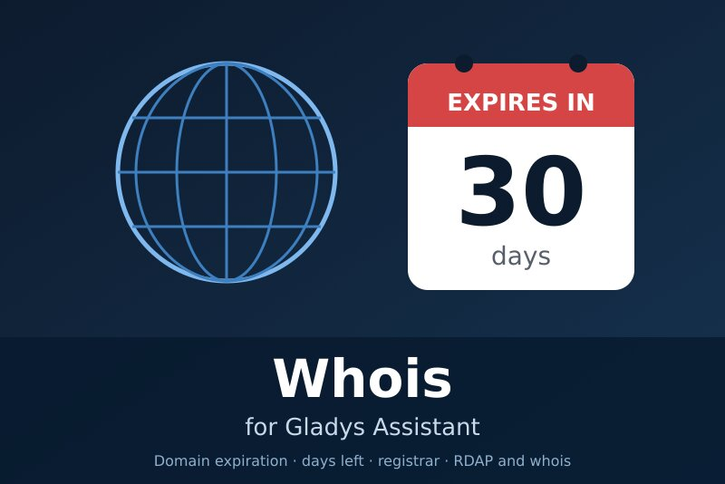
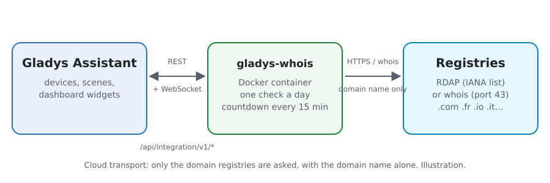
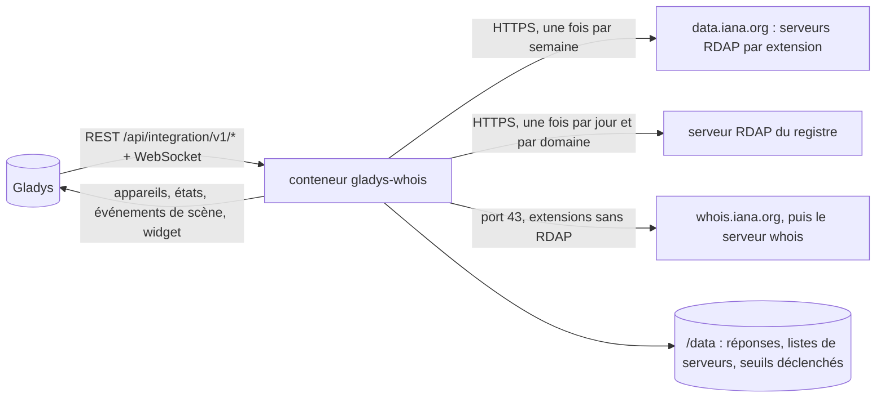
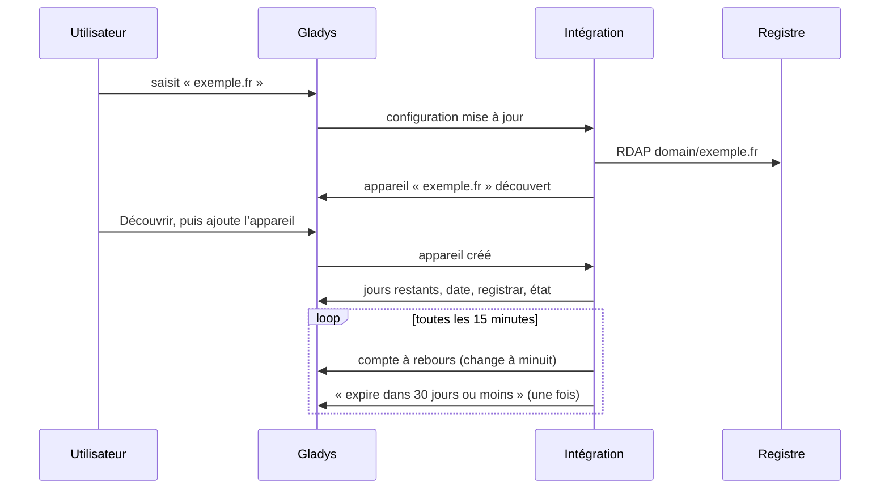
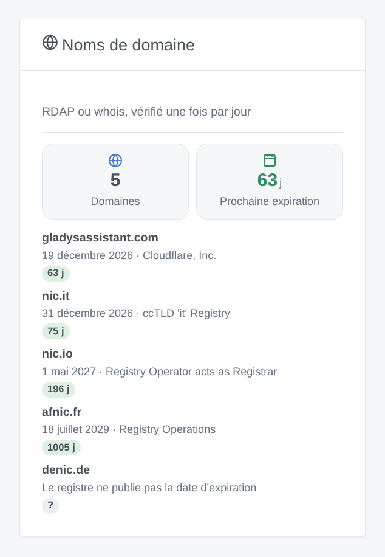

# Gladys Whois

[English](README.md) · **Français** · [Deutsch](README.de.md) · [Español](README.es.md)

[](LICENSE)
[](https://github.com/William-De71/gladys-whois/releases)
[](https://github.com/William-De71/gladys-whois/actions/workflows/release.yml)
[](https://gladysassistant.com)



Intégration externe [Gladys Assistant](https://gladysassistant.com) qui suit l’**expiration de vos noms de domaine** : jours restants, date d’expiration, registrar et état, vérifiés une fois par jour auprès de chaque registre par RDAP, ou par whois pour les extensions sans RDAP. Des scènes vous préviennent des semaines avant qu’un domaine expire, et un widget les liste, l’expiration la plus proche en premier.

Documentation utilisateur : [English](docs/en.md) · [Français](docs/fr.md) · [Deutsch](docs/de.md) · [Español](docs/es.md).

> Intégration communautaire, affiliée à aucun registre ni registrar.

## Fonctionnalités

- Jusqu’à **10 domaines**, saisis comme noms ou adresses web (`https://www.exemple.fr/` vaut `exemple.fr`), noms internationalisés compris (`café.fr`).
- Un **appareil par domaine** : jours avant expiration, date d’expiration, registrar, état (actif, expire bientôt, expiré, période de rédemption, suppression imminente).
- **2 déclencheurs de scène** (expire dans N jours ou moins, de 90 au jour même ; renouvelé), **1 action de scène** (lire l’expiration) et **1 widget**.
- **RDAP** pour .com, .net, .org, .fr, .uk, .nl et la plupart des extensions (liste des serveurs de l’IANA), **whois** pour les autres (.io, .it…). Ni compte, ni clé.
- Une requête par domaine et par jour, réponses gardées dans `/data` ; le compte à rebours suit le jour local de Gladys.
- Quatre langues partout : anglais, français, allemand, espagnol.

## Fonctionnement





De la configuration à une scène :



Le serveur RDAP de chaque extension vient du fichier d’amorçage de l’IANA (RFC 9224) ; pour les extensions qui n’en ont pas, le serveur whois est demandé une fois à whois.iana.org, puis interrogé sur le port 43, et sa réponse texte lue avec les noms de champs qu’emploient les registres.

### Transport

`transports: ["cloud"]` : l’intégration interroge les registres par Internet. Seul le nom de domaine figure dans les requêtes ; rien sur vous ne quitte votre réseau.

## Appareils et fonctionnalités

| Fonctionnalité         | Catégorie / type       | Unité |
| ---------------------- | ---------------------- | ----- |
| Jours avant expiration | `duration` / `integer` | jours |
| Date d’expiration      | `text` / `text`        | —     |
| Registrar              | `text` / `text`        | —     |
| État                   | `text` / `text`        | —     |

Un appareil par domaine, son identifiant externe bâti sur le nom ASCII du domaine (`exemple.fr`, `xn--caf-dma.fr`). Un domaine dont le registre ne publie pas de date d’expiration (.de, .eu, .be, .ch) n’a pas d’appareil : le widget et le statut de connexion en donnent la raison.

## Déclencheurs, actions de scène et widgets



**Widget** : Noms de domaine (combien, les jours avant la prochaine expiration, puis chaque domaine avec sa date, son registrar et les jours restants en pastille colorée).

**Déclencheurs** :

- **Domaine : expire bientôt** — dans 90, 60, 30, 14, 7, 3 ou 1 jour ou moins, ou le jour même ; une fois par date d’expiration, seulement le plus urgent quand plusieurs sont atteints d’un coup.
- **Domaine : renouvelé** — la date d’expiration a été repoussée.

**Action** : lire l’expiration d’un domaine, avec un résumé prêt pour un message.

Exemples :

- 30 jours avant → envoyer « exemple.fr expire dans 30 jours (19 décembre 2026). » sur Telegram.
- 7 jours avant → une notification sur tous les téléphones de la maison.
- Renouvelé → remercier le trésorier de l’association.

## Prérequis

- Gladys Assistant **5.3.0** ou plus récent (widgets et scènes ; mots-clés et pays du catalogue de Gladys 5.3) : les instances plus anciennes ne peuvent pas installer l’intégration.
- Un accès à Internet depuis Gladys, port 43 compris pour les extensions whois. Ni compte, ni clé.

## Installation

- **Depuis le store** : Intégrations → Whois → Installer.
- **Depuis l’URL du dépôt** : Intégrations → intégration externe → `https://github.com/William-De71/gladys-whois`.
- **Mode développeur** : lancer `npm start` avec les variables fournies par Gladys (voir Développement).

## Configuration

| Champ             | Défaut      | Rôle                                                              |
| ----------------- | ----------- | ----------------------------------------------------------------- |
| Noms de domaine   | —           | Jusqu’à dix, séparés par des virgules (`exemple.com, exemple.fr`) |
| Langue des textes | automatique | Noms des fonctionnalités, états texte et résumés de scène         |

Boutons : **Vérifier un domaine** (interroge tout de suite n’importe quel domaine, sans le suivre), **Vérifier maintenant**, **Diagnostic** (écrit l’état de l’intégration dans l’onglet Journaux, à joindre à un rapport de bug : Gladys ne transmet pas `DEBUG` au conteneur).

## Utilisation

1. Saisissez vos noms de domaine.
2. **Découvrir**, puis ajoutez les appareils.
3. Ajoutez le widget à un tableau de bord, et créez des scènes avec les déclencheurs et l’action.

## Développement

```bash
npm install
npm test                       # node --test, ne touche jamais au réseau
npm run lint                   # ESLint
npm run format:check           # Prettier
npx github:GladysAssistant/integration-store . --skip-image-check
scripts/build-cover.sh         # cover.jpg depuis docs/assets/cover.svg
docs/illustrations/render.sh   # docs/assets/widgets.<langue>.png
```

En local, le SDK lit `GLADYS_HOST_API_URL`, `GLADYS_INTEGRATION_TOKEN` et `GLADYS_INTEGRATION_SELECTOR` (fournis par Gladys en mode développeur) ; `TZ` fixe le fuseau. `DEBUG=gladys-integration-sdk` affiche les journaux du SDK.

Les tests utilisent de vraies réponses des registres (RDAP de Verisign et de l’Afnic, whois de .io, .it et .de) : lecture RDAP et whois, dates, noms de domaine, appareils (les champs qu’exige l’écran de découverte), événements de scène (une fois par seuil, renouvellement), widget (`validateWidgetContent`), manifeste, quatre langues, script de release, et l’intégration entière face au faux Gladys du SDK. `test/structure.test.js` fige chaque clé que les utilisateurs enregistrent.

## Processus de release


Chaque fusion sur `main` lance la CI, puis calcule la version à partir des [Conventional Commits](https://www.conventionalcommits.org/) depuis le dernier tag : `feat` → mineure, `fix` / `perf` → correctif, `!` ou `BREAKING CHANGE` → majeure (une mineure tant qu’on est sous 1.0.0) ; `docs`, `chore`, `ci`, `test`, `style`, `refactor`, `build` seuls ne publient rien. La section du changelog est générée, le tag poussé, l’image multi-architecture construite, puis `main` reçoit le commit de release, la GitHub Release est créée et un dernier job vérifie l’image publique, le validateur du store et le topic.

- Le titre de la pull request devient le commit squashé, puis la ligne du changelog : écrivez-le en anglais, pour l’utilisateur (`pr-title.yml` le vérifie). Ne modifiez jamais `CHANGELOG.md` à la main.
- 1.0.0 est une décision : Actions → Release → Run workflow avec `release-as: 1.0.0`. `dry-run` montre la version et les notes sans rien publier.
- **Branche protégée** : la release pousse son commit sur `main` avec `GITHUB_TOKEN`. Avec une règle sur `main`, ajoutez GitHub Actions à sa liste de contournement (ou poussez via une GitHub App), sinon le job de publication échoue avec des instructions.
- Après la première release, vérifiez que le paquet `ghcr.io` est public (Package settings → Change visibility), sinon Gladys ne peut pas le télécharger.

## Dépannage

Voir [docs/fr.md](docs/fr.md#dépannage). Signalez un problème avec les versions de Gladys et de l’intégration, le domaine concerné et la sortie du bouton **Diagnostic** (onglet Journaux).

## Contribuer

Issues et pull requests bienvenues. Lancez `npm run format:check && npm run lint && npm test` avant d’ouvrir une pull request, et gardez chaque identifiant externe et chaque clé enregistrée inchangés (voir [CLAUDE.md](CLAUDE.md)).

## Sécurité

Voir [SECURITY.md](SECURITY.md) : signalez les vulnérabilités en privé. L’intégration n’a ni secret ni compte ; elle n’écrit que dans `/data`.

## Captures à venir

Les images ci-dessus sont des illustrations, pas des captures. Les vraies captures iront dans `docs/assets/screenshots/` (PNG, 1280 × 800) : `configuration.png`, `discovery.png`, `device.png`, `scene.png`.

## Licence

[Licence Apache 2.0](LICENSE) — voir aussi [NOTICE](NOTICE). Les données d’enregistrement appartiennent aux registres ; ce dépôt ne contient que quelques réponses enregistrées pour les tests.
