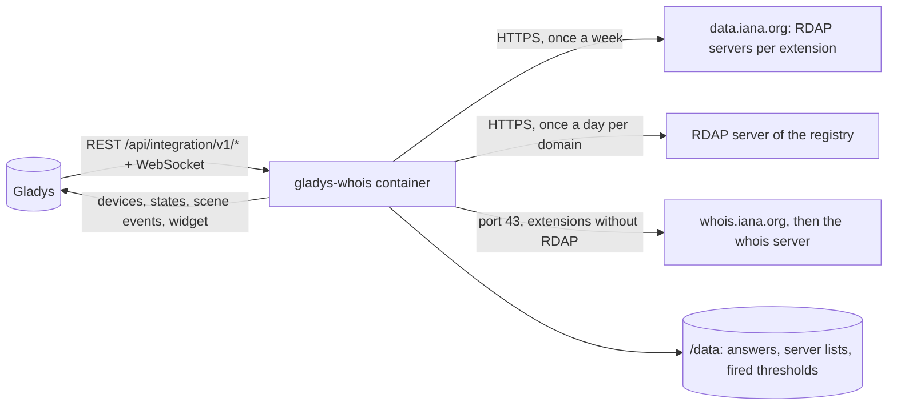
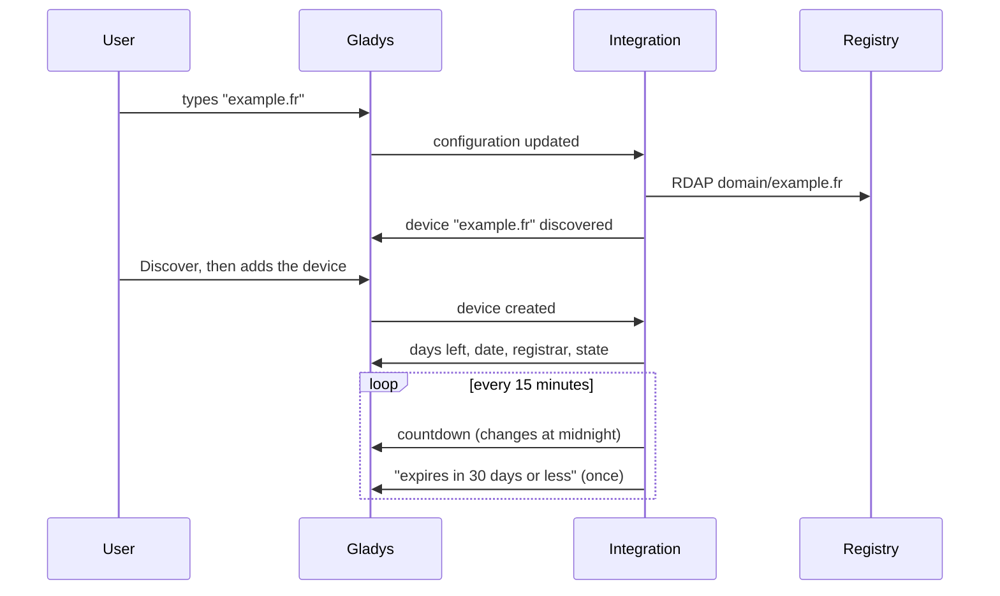
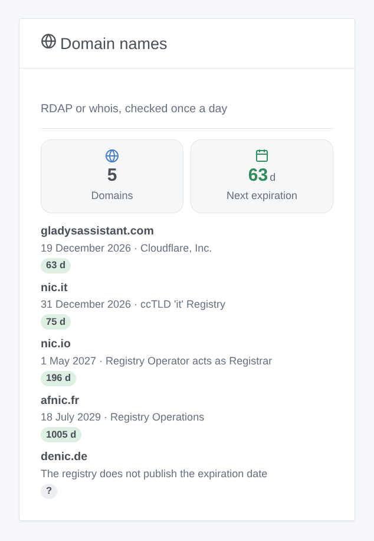

# Gladys Whois

**English** · [Français](README.fr.md) · [Deutsch](README.de.md) · [Español](README.es.md)

[](LICENSE)
[](https://github.com/William-De71/gladys-whois/releases)
[](https://github.com/William-De71/gladys-whois/actions/workflows/release.yml)
[](https://gladysassistant.com)


[Gladys Assistant](https://gladysassistant.com) external integration that follows the **expiration of your domain names**: days left, expiration date, registrar and state, checked once a day with each registry through RDAP, or whois for the extensions without RDAP. Scenes warn you weeks before a domain expires, and a widget lists them, the closest expiration first.

User documentation: [English](docs/en.md) · [Français](docs/fr.md) · [Deutsch](docs/de.md) · [Español](docs/es.md).

> Community integration, affiliated with no registry nor registrar.

## Features

- Up to **10 domains**, typed as names or web addresses (`https://www.example.fr/` is `example.fr`), internationalized names included (`café.fr`).
- One **device per domain**: days before expiration, expiration date, registrar, state (active, expires soon, expired, redemption period, pending deletion).
- **2 scene triggers** (expires in N days or less, from 90 to the day; renewed), **1 scene action** (read the expiration) and **1 widget**.
- **RDAP** for .com, .net, .org, .fr, .uk, .nl and most extensions (server list of the IANA), **whois** for the others (.io, .it…). No account, no key.
- One request per domain and per day, answers kept in `/data`; the countdown follows the local day of Gladys.
- Four languages everywhere: English, French, German, Spanish.

## How it works




From the configuration to a scene:



The RDAP server of each extension comes from the IANA bootstrap file (RFC 9224); for the extensions without one, the whois server is asked to whois.iana.org once, then queried on port 43, and its text answer read with the field names registries use.

### Transport

`transports: ["cloud"]`: the integration asks the registries over the internet. Only the domain name is in the requests; nothing about you leaves your network.

## Devices and features

| Feature                | Category / type        | Unit |
| ---------------------- | ---------------------- | ---- |
| Days before expiration | `duration` / `integer` | days |
| Expiration date        | `text` / `text`        | —    |
| Registrar              | `text` / `text`        | —    |
| State                  | `text` / `text`        | —    |

One device per domain, its external id built on the ASCII name of the domain (`example.fr`, `xn--caf-dma.fr`). A domain whose registry publishes no expiration date (.de, .eu, .be, .ch) gets no device: the widget and the connection status give the reason.

## Scene triggers, actions and widgets



**Widget**: Domain names (how many, the days before the next expiration, then each domain with its date, registrar and days left as a colored badge).

**Triggers**:

- **Domain: expires soon** — in 90, 60, 30, 14, 7, 3 or 1 day or less, or on the day; once per expiration date, only the most urgent when several are reached at once.
- **Domain: renewed** — the expiration date moved forward.

**Action**: read the expiration of a domain, with a summary ready for a message.

Examples:

- 30 days before → send "example.fr expires in 30 days (19 December 2026)." on Telegram.
- 7 days before → a notification on every phone of the house.
- Renewed → thank the treasurer of the association.

## Requirements

- Gladys Assistant **5.1.0** or newer (widgets and scenes): older instances cannot install the integration.
- Internet access from Gladys, port 43 included for the whois extensions. No account, no key.

## Installation

- **From the store**: Integrations → Whois → Install.
- **From the repository URL**: Integrations → external integration → `https://github.com/William-De71/gladys-whois`.
- **Developer mode**: run `npm start` with the variables Gladys provides (see Development).

## Configuration

| Field                 | Default   | Role                                                       |
| --------------------- | --------- | ---------------------------------------------------------- |
| Domain names          | —         | Up to ten, separated by commas (`example.com, example.fr`) |
| Language of the texts | automatic | Feature names, text states and scene summaries             |

Buttons: **Check a domain** (asks any domain right away, without following it), **Check now**, **Diagnostic** (writes the state of the integration to the Logs tab, to attach to a bug report: Gladys does not pass `DEBUG` to the container).

## Usage

1. Type your domain names.
2. **Discover**, then add the devices.
3. Add the widget to a dashboard, and create scenes with the triggers and the action.

## Development

```bash
npm install
npm test                       # node --test, never touches the network
npm run lint                   # ESLint
npm run format:check           # Prettier
npx github:GladysAssistant/integration-store . --skip-image-check
scripts/build-cover.sh         # cover.jpg from docs/assets/cover.svg
docs/illustrations/render.sh   # docs/assets/widgets.<language>.png
```

Locally, the SDK reads `GLADYS_HOST_API_URL`, `GLADYS_INTEGRATION_TOKEN` and `GLADYS_INTEGRATION_SELECTOR` (provided by Gladys in developer mode); `TZ` sets the timezone. `DEBUG=gladys-integration-sdk` shows the SDK logs.

The tests use real answers of the registries (Verisign and Afnic RDAP, .io, .it and .de whois): reading of RDAP and whois, dates, domain names, devices (the fields the Discovery screen requires), scene events (once per threshold, renewal), widget (`validateWidgetContent`), manifest, four languages, release script, and the whole integration against the fake Gladys of the SDK. `test/structure.test.js` freezes every key users store.

## Release process


Every merge on `main` runs the CI, then computes the version from the [Conventional Commits](https://www.conventionalcommits.org/) since the last tag: `feat` → minor, `fix` / `perf` → patch, `!` or `BREAKING CHANGE` → major (a minor while below 1.0.0); `docs`, `chore`, `ci`, `test`, `style`, `refactor`, `build` alone publish nothing. The changelog section is generated, the tag pushed, the multi-architecture image built, then `main` receives the release commit, the GitHub Release is created and a last job checks the public image, the store validator and the topic.

- The pull request title becomes the squash commit, then the changelog line: write it in English, for the user (`pr-title.yml` checks it). Never edit `CHANGELOG.md` by hand.
- 1.0.0 is a decision: Actions → Release → Run workflow with `release-as: 1.0.0`. `dry-run` shows the version and the notes without publishing anything.
- **Protected branch**: the release pushes its commit to `main` with `GITHUB_TOKEN`. With a rule on `main`, add GitHub Actions to its bypass list (or push through a GitHub App), otherwise the publish job fails with instructions.
- After the first release, check that the `ghcr.io` package is public (Package settings → Change visibility), otherwise Gladys cannot download it.

## Troubleshooting

See [docs/en.md](docs/en.md#troubleshooting). Report problems with the versions of Gladys and of the integration, the domain concerned and the output of the **Diagnostic** button (Logs tab).

## Contributing

Issues and pull requests welcome. Run `npm run format:check && npm run lint && npm test` before opening a pull request, and keep every external id and stored key unchanged (see [CLAUDE.md](CLAUDE.md)).

## Security

See [SECURITY.md](SECURITY.md): report vulnerabilities privately. The integration has no secret and no account; it only writes to `/data`.

## Screenshots to come

The images above are illustrations, not screenshots. Real screenshots will go to `docs/assets/screenshots/` (PNG, 1280 × 800): `configuration.png`, `discovery.png`, `device.png`, `scene.png`.

## License

[Apache License 2.0](LICENSE) — see also [NOTICE](NOTICE). The registration data belongs to the registries; this repository only holds a few answers recorded for the tests.
